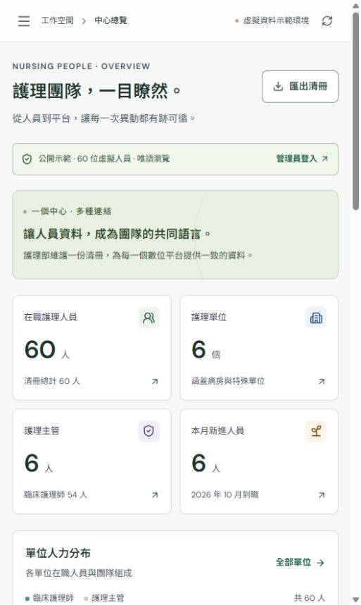

# NurseHub 護理人員資料中心

護理部自主維護的人員主資料與平台資格服務，作為其他數位平台的共同人員來源。

公開唯讀 Demo 入口：<https://nursing-people-hub-demo.chih-wei-chang.chatgpt.site>（發布結果以工具成功回報為準）。初始資料全部虛構；沒有匯入真實員工資料。

## Demo 配置

內科病房、外科病房、加護病房、急診室、婦產科病房、兒科病房：每單位 10 人，含 1 位護理主管、9 位臨床護理師。合計 60 人（6 主管、54 臨床）。

4 個範例平台：護理教育訓練、臨床能力認證、新人培育計畫、單位管理平台。可另行新增平台；這些範例只管理資格，沒有部署對應的實際業務系統。

## 可以操作

- 總覽、搜尋／篩選／分頁清冊、CSV 匯出、各單位人力。
- 新進建檔、編輯、轉調、離職／留停／復職、保留前後異動與生效日。
- 固定人員 ID，職務與平台資格分開維護；離職／留停停用資格，復職後重新授權。
- 自訂平台、每人每平台資格；各呼叫端獨立金鑰、單位範圍與平台資格篩選。
- 唯讀 `/api/v1/staff`、`/api/v1/units`、`/api/v1/changes`、`/api/openapi`。
- D1 伺服器持久化、金鑰雜湊、版本衝突與原子異動。

## 試用順序

1. 人員清冊搜尋並點選人員，檢視資料及資格。
2. 在人員詳細畫面辦理轉調，再到人員異動查看紀錄。
3. 新增自己的數位平台，為人員管理使用資格。
4. 建立該平台專屬 API 金鑰，指定單位與資格範圍，在 API 測試工具驗證。
5. 離職／復職後重新查詢，檢查資格變動。外部平台須實際串接才會配合同步。

## 本機啟動

需要 Node >=22.13、Git 與 npm。可執行 `start-demo.ps1`，優先使用桌面內建 Node 24；此腳本不會安裝依賴或建立資料表。

```powershell
npm ci
npm run build
node --import ./scripts/sites-env.mjs ./node_modules/wrangler/bin/wrangler.js d1 execute DB --local --config dist/server/wrangler.json --persist-to .wrangler/state --file drizzle/0000_previous_mojo.sql
npm run dev -- --port 5173 --hostname 127.0.0.1
```

本機 migration 僅在新資料庫執行一次。開啟輸出的網址即可瀏覽分享 Demo；管理操作需登入。本機 starter 使用 loopback 模擬身分，雲端管理操作須以已授權的管理員登入。不要把本機模擬登入用於正式環境。

本機 `.wrangler` 資料與雲端 D1 分開，不會隨來源發布。封裝只含建置輸出、設定及 migration，金鑰與 runtime 資料不進 Git。

## 文件

- [對比與字級完整前後對照](docs/對比與字級_完整前後對照.md)：2026-10-28 深色文字、較大字級、狀態與表單對比改善；含完整修改前後樣式。

- [基礎服務與串接](docs/基礎服務與串接.md)：資料模型、API、同步及正式上線界線。
- [驗證紀錄](docs/驗證紀錄.md)：16 項整合檢查與瀏覽器實測範圍。
- [修改對照](docs/修改對照.md)：新建來源與關鍵完整程式位置。

這是基礎服務首版與公開唯讀虛擬資料 Demo。管理資料由環境設定中的管理員名單授權，分享訪客只取得固定虛擬資料快照。正式院內使用尚需分權、備份復原、維運與實際平台驗收；服務 API 仍需專用金鑰；共用登入尚未建置。

## 分享與管理分隔

分享網址不需登入，可搜尋、篩選及查看固定 60 位虛擬人員。管理員登入後才可讀寫實際資料庫、異動及金鑰；管理員 email 名單放在 Sites 的 NURSEHUB_ADMIN_EMAILS 環境設定，不寫入來源。一般登入訪客仍為唯讀，無法取得管理資料庫內容。

## GitHub 原始碼

儲存庫：<https://github.com/luckyseal0923/NurseHub>。此版由已發布的 NurseHub 版本 3 匯出，原平台來源 commit 為 `a972f1125c63a8f3dcf483a2268a24a962b99c69`。環境設定、執行期資料庫、金鑰及本機 QA 資料不包含在儲存庫內。


